<div align="center">

<a href="#the-idea"></a>

# Old Skool Daters

### Find people. Talk to them. Follow the thread.

**A world of people. A simpler way to connect.**

*Global discovery × The Red Thread of Fate*

<p>
<a href="#the-idea">The idea</a> ·
<a href="#experience">Explore</a> ·
<a href="#discovery-modes">Discover</a> ·
<a href="#talk-to-me">Talk to Me</a> ·
<a href="#working-prototype">Real screenshots</a> ·
<a href="#try-it-locally">Run locally</a>
</p>

<a href="docs/images/concepts/01-vision.webp">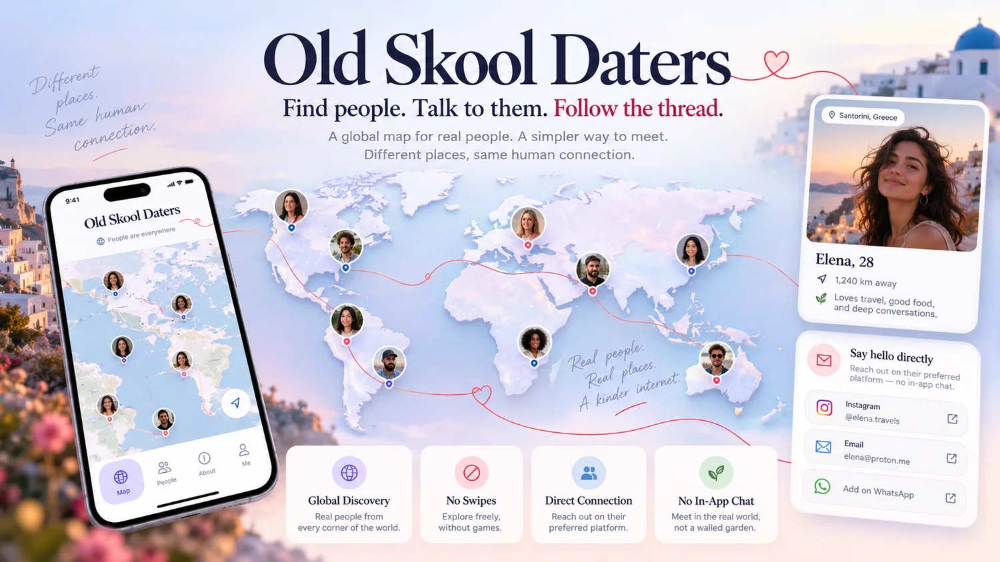</a>

<sub>Concept illustration · Example profiles and locations are fictional · Click the image to enlarge</sub>

</div>

---

<a id="the-idea"></a>
## Why does this exist?

**Because connection should not be a premium feature.**

It should be easy to discover someone and say hello. Yet so many dating apps put obstacles in the way: swipes, likes, mutual-match gates, expensive conversation unlocks, and an inbox you have to stay inside. Something human starts feeling like a complicated transaction.

**Old Skool Daters grew out of frustration with that experience.** It is a small experiment in making the first step simple again. Open the world. Find someone. See a little of who they are. If they have chosen to share a way to be reached, say hello on that platform.

The project borrows a beautiful idea from *Akai Ito*, the Japanese **Red Thread of Fate**: people can be connected in ways we cannot plan. Here, the thread is a metaphor, **not an algorithm claiming to know your destiny**.

> **The world map makes discovery possible. The Red Thread explains why discovery matters.**

No swiping to win permission. No compatibility score deciding who matters. No payment to unlock a conversation. Just a way to discover people, everywhere, with respect for their choices and privacy.

<a href="docs/images/concepts/02-global-map.webp">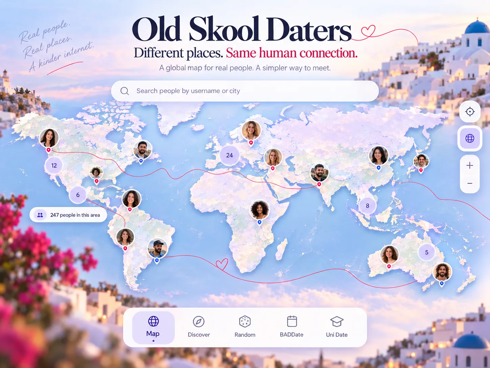</a>

<p align="center"><sub>A world map, not a catalogue of people. Design concept.</sub></p>

---

## One simple journey

<a href="docs/images/how-it-works.svg">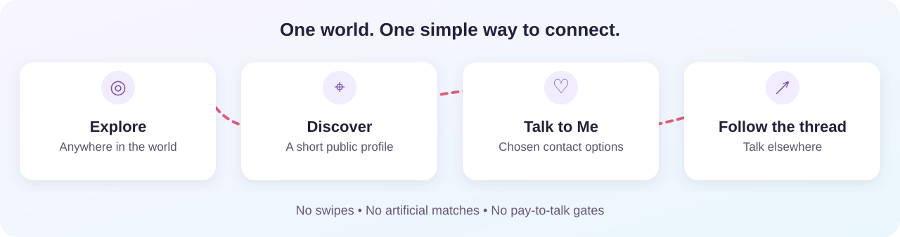</a>

**Explore → Discover → Talk to Me → Follow the thread.** Every discovery mode leads back to this same path. The app is the doorway, not the conversation room.

---

<a id="experience"></a>
## Pick an experience

These links work inside GitHub. Open the part of the product you're curious about, or explore the entire walkthrough below.

<table>
<tr>
<td align="center" width="33%"><a href="#world-map"><strong>🌍 World map</strong></a><br/>Explore anywhere</td>
<td align="center" width="33%"><a href="#local-discovery"><strong>📍 Zoom closer</strong></a><br/>See small previews</td>
<td align="center" width="33%"><a href="#direct-search"><strong>🔎 Search</strong></a><br/>Find a username</td>
</tr>
<tr>
<td align="center"><a href="#discovery-modes"><strong>🎲 Surprise discovery</strong></a><br/>Five different paths</td>
<td align="center"><a href="#talk-to-me"><strong>↗ Talk to Me</strong></a><br/>Direct contact options</td>
<td align="center"><a href="#working-prototype"><strong>🖼 Actual app</strong></a><br/>Real local screenshots</td>
</tr>
</table>

<a id="world-map"></a>
### 01 / The world is the home screen

You don't need to wait for suggestions from an opaque feed. Explore cities, countries, and continents. People who choose to be discoverable appear as small markers, with clusters keeping busy areas readable.

<a href="docs/images/concepts/02-global-map.webp"></a>

<a id="local-discovery"></a>
### 02 / Get closer, without losing the world

Zoom into a place, tap a marker, and view a compact profile. The map stays at the center instead of forcing users into endless profile screens.

<a href="docs/images/concepts/03-neighborhood.webp"></a>

<a id="direct-search"></a>
### 03 / Know a username? Find that person.

The unique username is a direct route to a profile. Searching is navigation, not an algorithm deciding who is the better partner.

<a href="docs/images/concepts/04-username-search.webp"></a>

---

<a id="discovery-modes"></a>
## Discover in your own way

**Five different ways to find someone. Zero compatibility scores.** Choose a mode to jump to it, then open the full-screen designs or compare them with screenshots of the working prototype.

[Random](#random-mode) · [Wheel of Love](#wheel-mode) · [BADDate](#baddate-mode) · [Uni Date](#uni-mode) · [Love Referrals](#referral-mode)

<a id="random-mode"></a>
### 🎲 Random / Leave it to chance

No match ceremony and no judgement. One eligible, discoverable person appears. You can open their profile or try again.

<p align="center"><a href="docs/images/concepts/05-random.webp">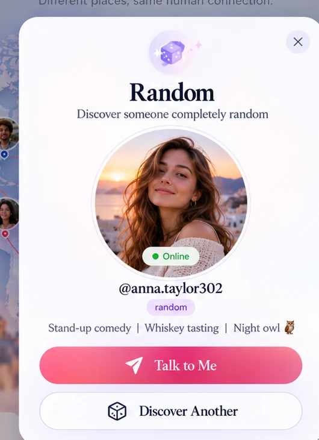</a><br/><sub>Focused concept • Tap to see the full design</sub></p>

<details>
<summary><b>See the complete Random design and its current prototype</b></summary>

<a href="docs/images/concepts/05-random.webp">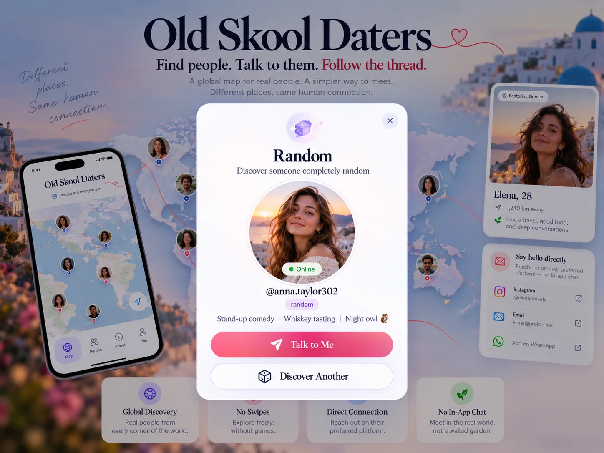</a>
<a href="docs/images/prototype/06-random.webp"></a>

</details>

<a id="wheel-mode"></a>
### ✨ Wheel of Love / A little surprise

A playful spin leads to someone discoverable. Spins aren't bought with credits and the wheel doesn't claim to identify a soulmate.

<p align="center"><a href="docs/images/concepts/06-wheel.webp">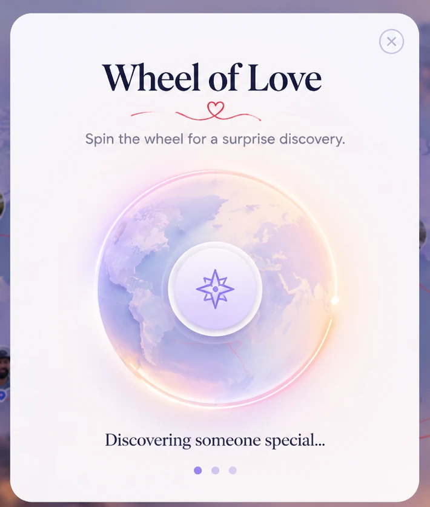</a><br/><sub>Focused concept • Tap to see the full design</sub></p>

<details>
<summary><b>See the full Wheel of Love design</b></summary>

<a href="docs/images/concepts/06-wheel.webp">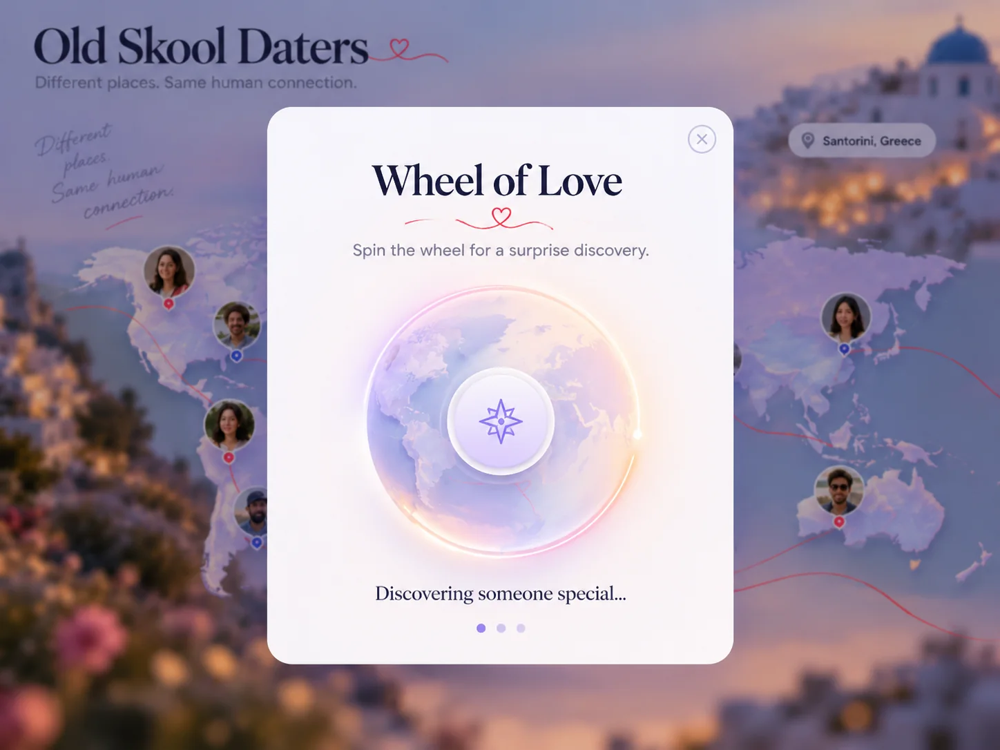</a>

</details>

<a id="baddate-mode"></a>
### 🔀 BADDate / Meet somebody unexpected

BADDate embraces contrasting everyday interests. Different taste isn't a bad person, and sensitive characteristics aren't a reason to label someone a bad match.

<p align="center"><a href="docs/images/concepts/07-baddate.webp">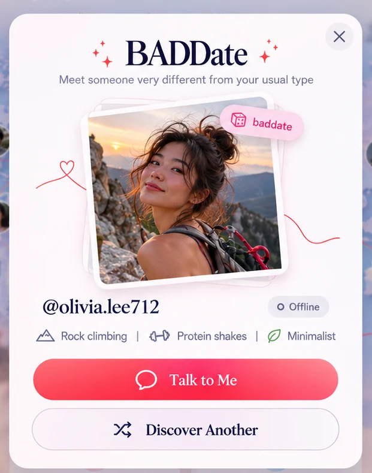</a><br/><sub>Focused concept • Tap to see the full design</sub></p>

<details>
<summary><b>See the complete BADDate design and its current prototype</b></summary>

<a href="docs/images/concepts/07-baddate.webp">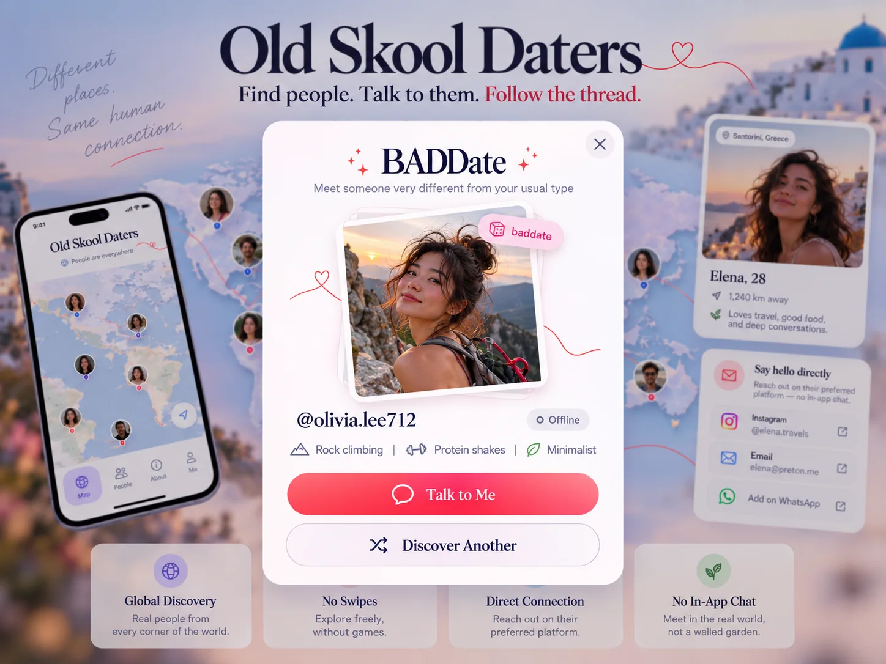</a>
<a href="docs/images/prototype/07-baddate.webp">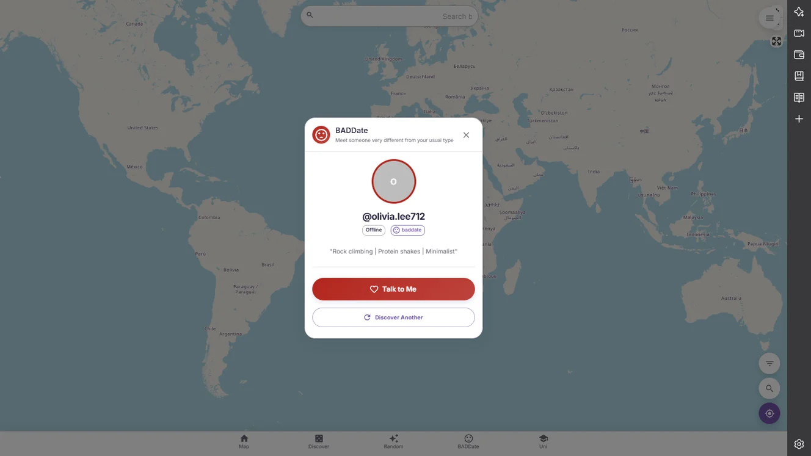</a>

</details>

<a id="uni-mode"></a>
### 🎓 Uni Date / Familiar ground, new people

Discover users associated with a university. University affiliation is a discovery context, not proof of identity unless explicitly verified.

<p align="center"><a href="docs/images/concepts/08-uni.webp">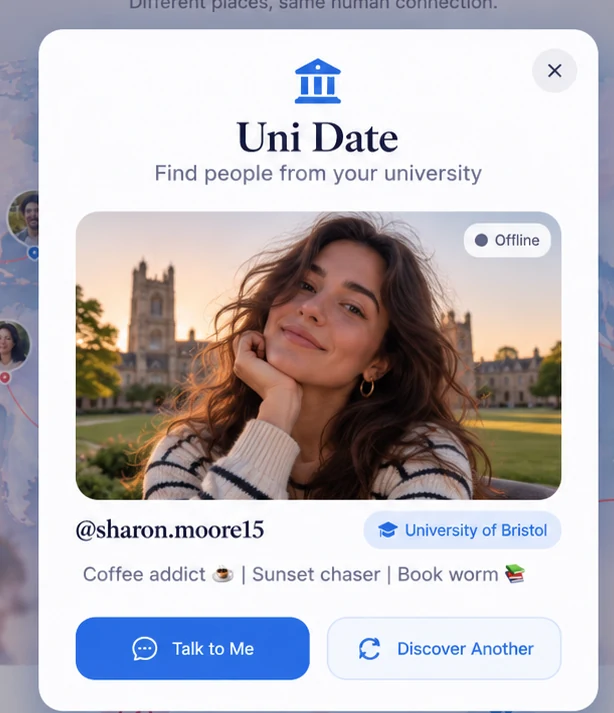</a><br/><sub>Focused concept • Tap to see the full design</sub></p>

<details>
<summary><b>See the complete Uni Date design and its current prototype</b></summary>

<a href="docs/images/concepts/08-uni.webp">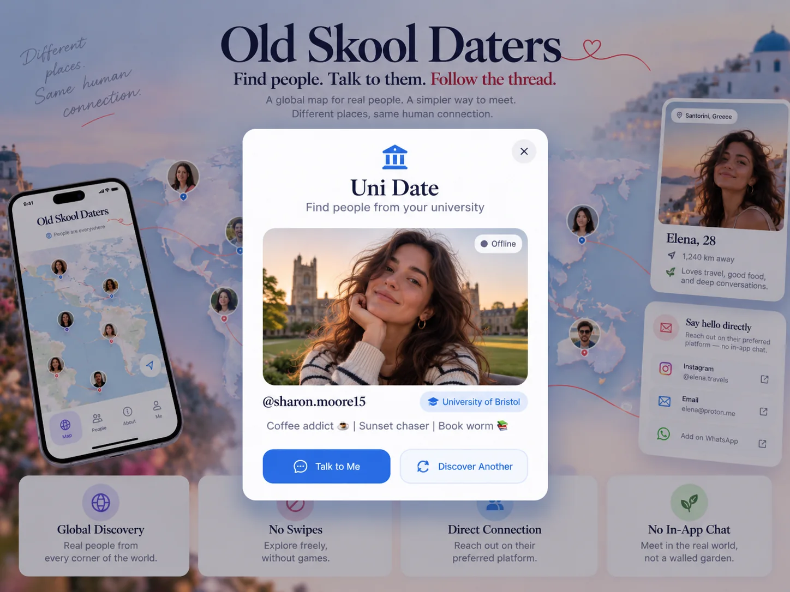</a>
<a href="docs/images/prototype/08-uni.webp">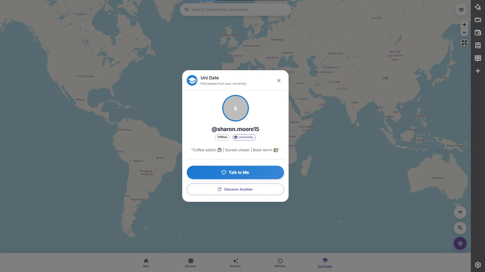</a>

</details>

<a id="referral-mode"></a>
### 🤝 Love Referrals / An introduction, not a ranking

Someone can introduce you to a person they know. The idea is a voluntary human recommendation, not a popularity contest. Permission and privacy safeguards for referrals still need work before public release.

<details>
<summary><b>How is this different from traditional matching?</b></summary>

A referral is a way to discover somebody. It is **not** a like, a match score, a paid introduction, or a promise that the other person wants to be contacted. Users still control what they share, and blocking must be respected.

</details>

---

<a id="talk-to-me"></a>
## Talk to Me / The most important button

**Find them here. Talk where you already talk.** There is no built-in inbox. A profile can share social handles and contact links, and you choose from the methods that person has published. Private information must never be silently unlocked.

<p align="center"><a href="docs/images/concepts/09-talk-to-me.webp">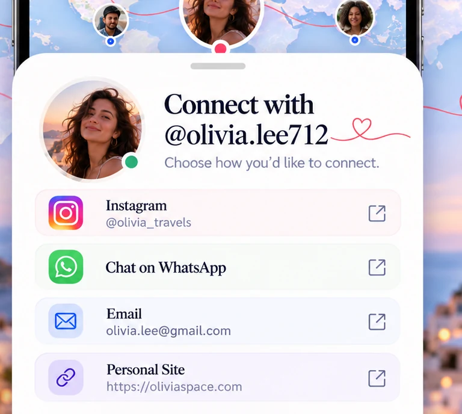</a><br/><sub>Focused contact panel · Click to view full concept</sub></p>

<details>
<summary><b>Open the complete Talk to Me illustration</b></summary>

<a href="docs/images/concepts/09-talk-to-me.webp">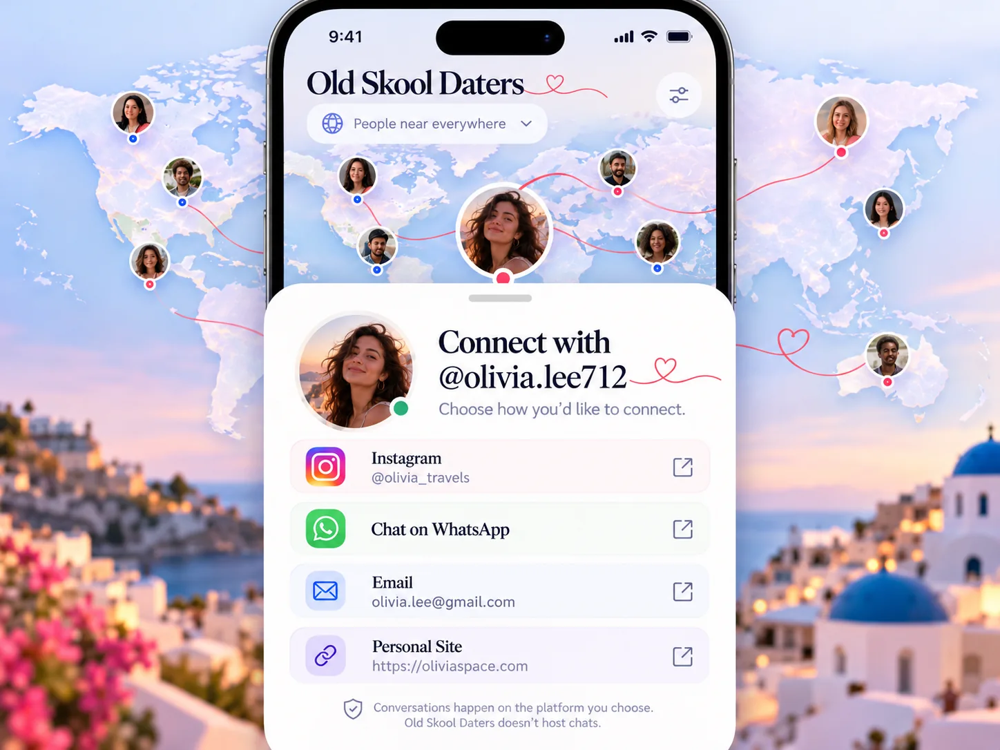</a>

</details>

<p align="center"><sub>Illustrative contact details only. Real profiles control their own shared links.</sub></p>

<details>
<summary><b>What if someone hasn't shared a contact method?</b></summary>

Then **Talk to Me** should explain that contact is unavailable, not lead to a broken promise. Here's the proposed empty state:

<a href="docs/images/concepts/13-no-contact.webp">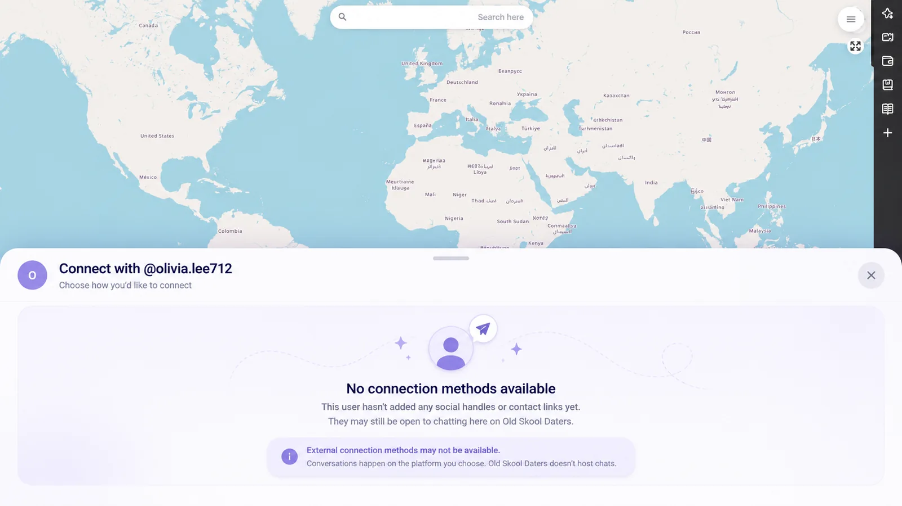</a>

</details>

---

## Small profiles. Clear choices.

People aren't résumés. Their public profile stays intentionally brief: **photo, unique username, availability, short description, and contact options they choose to share**.

### Make your profile yours

<a href="docs/images/concepts/10-edit-profile.webp">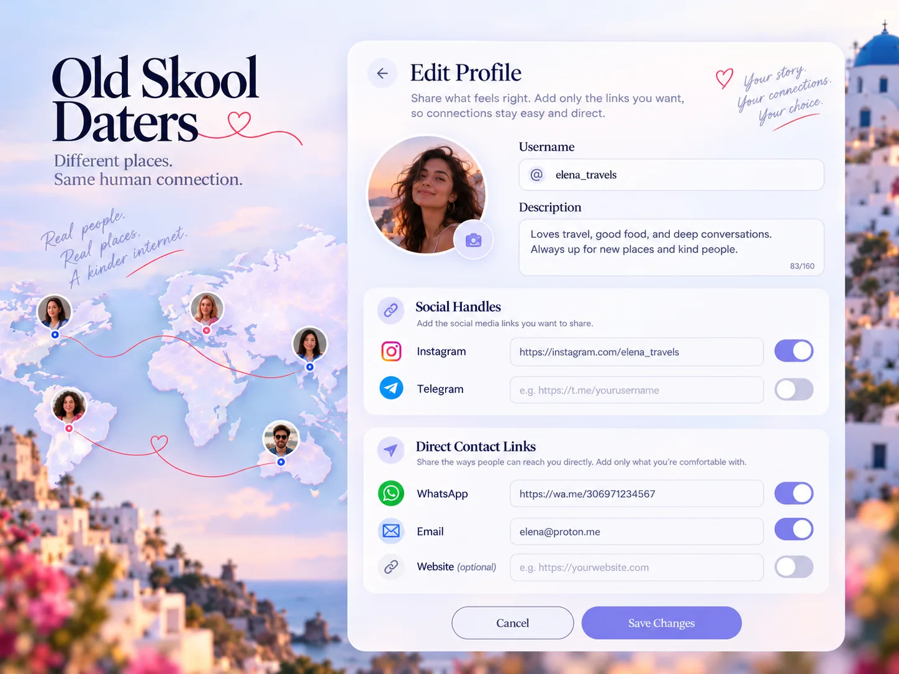</a>

### Stay in control

The original idea has an intentional **Online / Offline** choice. Offline does not automatically remove someone from discovery, but an old location must never be presented as live GPS data. Approximate display and expiration rules need to be finalized before public use.

<a href="docs/images/availability.svg">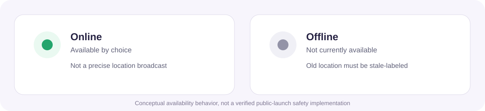</a>

<a href="docs/images/concepts/11-settings.webp">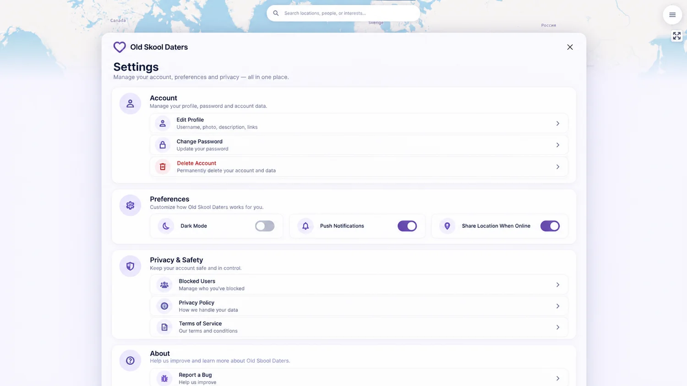</a>

<details>
<summary><b>Peek at the sign-in experience</b></summary>

<a href="docs/images/concepts/12-sign-in.webp">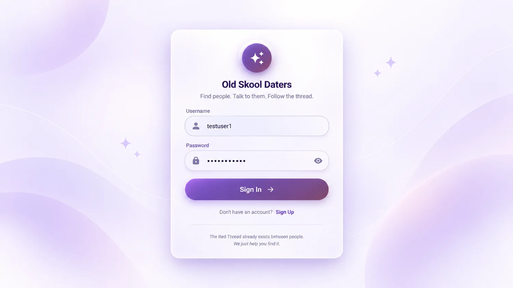</a>

</details>

---

<a id="working-prototype"></a>
## See the actual local prototype

Everything above is clearly labeled **design exploration**. Below are **real screenshots of the running local project**, kept separate so illustrations aren't mistaken for shipped interface changes. Demo profiles are synthetic, not verified active members.

<details open>
<summary><b>🌍 Maps and finding people</b></summary>

<a href="docs/images/prototype/01-world-view.webp">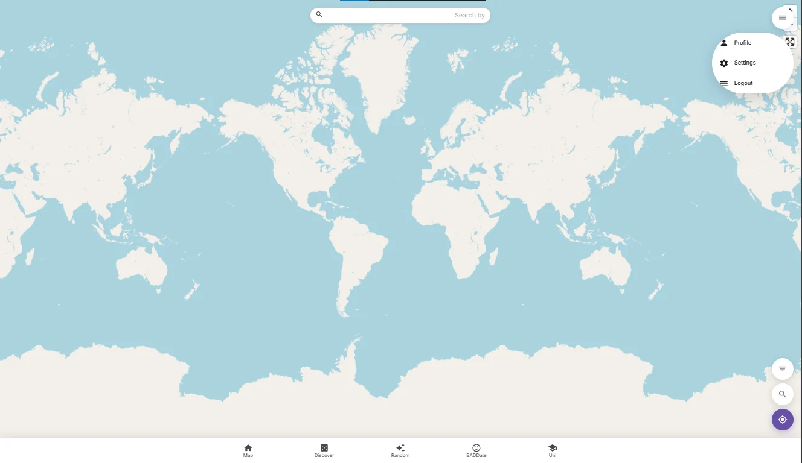</a>

<a href="docs/images/prototype/04-search.webp">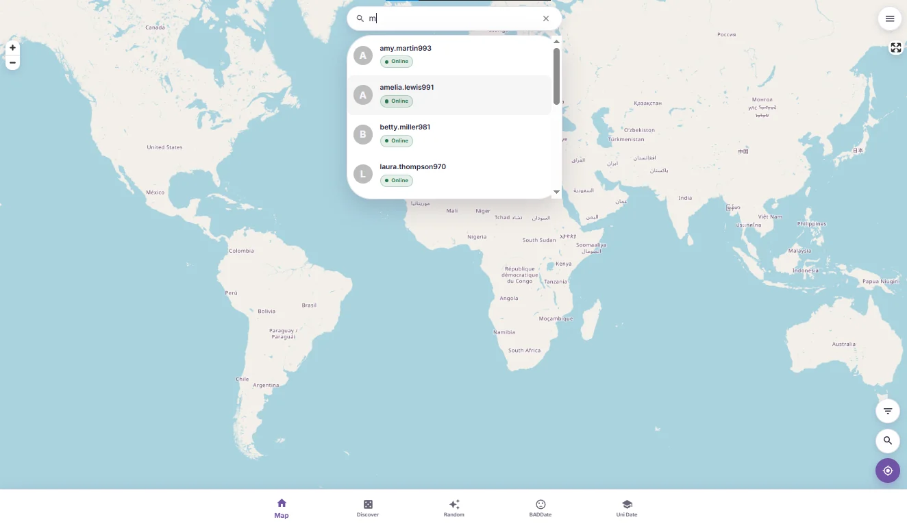</a>

<a href="docs/images/prototype/05-profile-on-map.webp">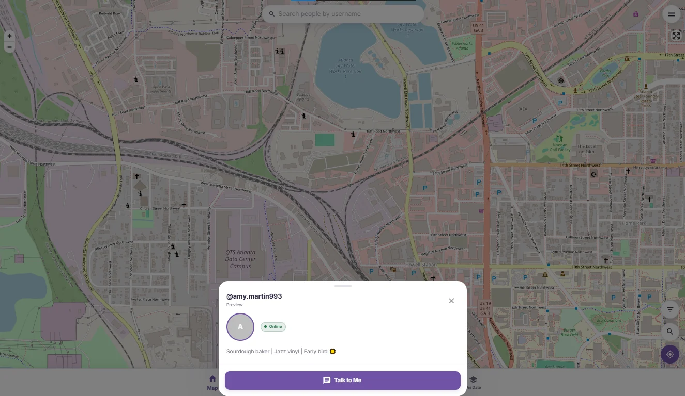</a>

</details>

<details>
<summary><b>🧭 More map views</b></summary>

<a href="docs/images/prototype/02-map.webp">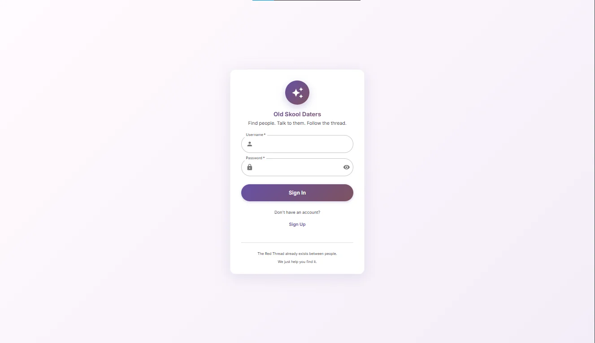</a>
<a href="docs/images/prototype/03-zoomed-map.webp">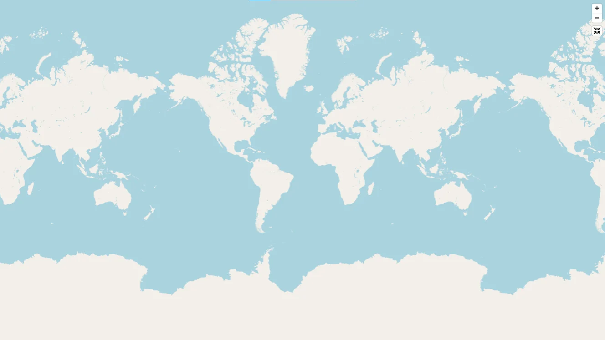</a>

</details>

<details>
<summary><b>🎲 Working discovery screens (Random, BADDate, Uni Date)</b></summary>

<a href="docs/images/prototype/06-random.webp"></a>
<a href="docs/images/prototype/07-baddate.webp"></a>
<a href="docs/images/prototype/08-uni.webp"></a>

</details>

<details>
<summary><b>↗ Connections and user account</b></summary>

<a href="docs/images/prototype/09-connections.webp"></a>
<a href="docs/images/prototype/10-edit-profile.webp"></a>
<a href="docs/images/prototype/11-settings.webp">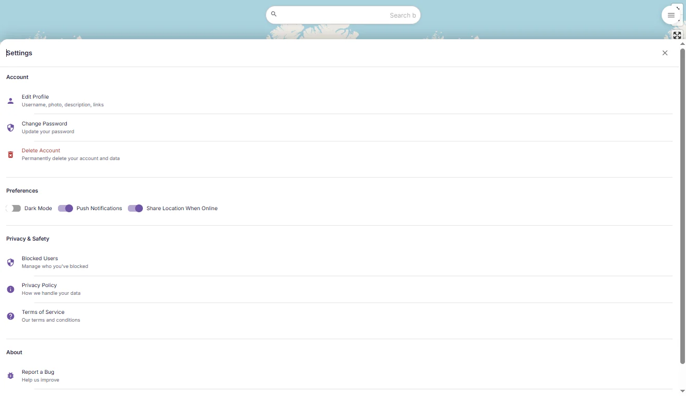</a>
<a href="docs/images/prototype/12-customization.webp">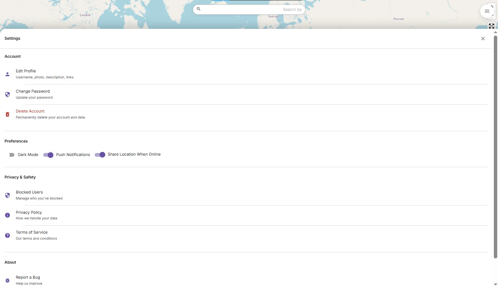</a>
<a href="docs/images/prototype/13-login.webp">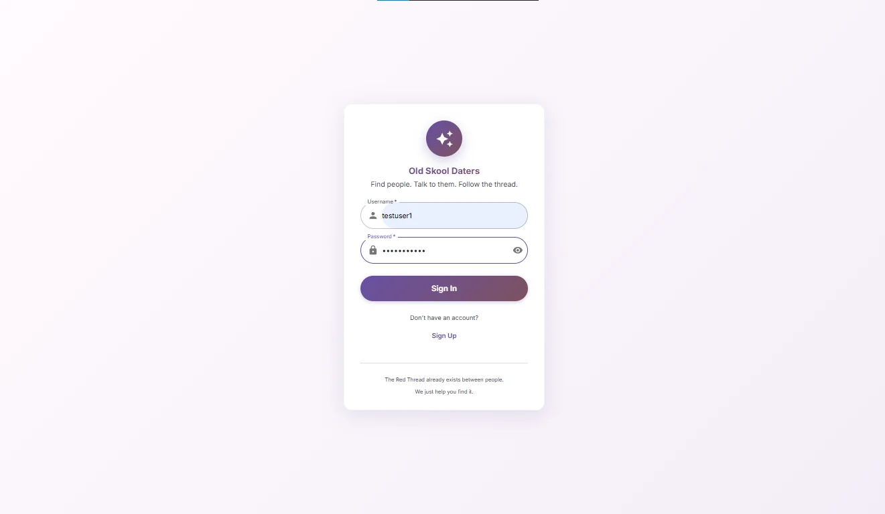</a>

</details>

---

## What makes it Old Skool?

| Many dating apps | Old Skool Daters |
|:---|:---|
| Swipe until you match | Explore a real map and discover people |
| Wait for mutual-match approval | No match gate before seeing voluntarily shared contacts |
| Pay to unlock conversations | No paid messaging gate in the concept |
| Opaque compatibility ranking | No compatibility score or partner ranking |
| Stay in a built-in chat | Continue through chosen external platforms |
| Long matching questionnaires | A compact public profile |

**Less machinery between people doesn't mean fewer safety rules.** Adult eligibility, consent, blocking, reporting, protecting location privacy, and controlling public contact information matter especially in a direct-connect product.

---

<a id="try-it-locally"></a>
## Run it locally

This is a **local prototype**, not an active public dating service. You can explore it on your computer without deploying anything.

**What you need:** Node.js, [pnpm](https://pnpm.io/installation), and a copy of the full application repository (including the `packages/` directory).

```bash
pnpm install
pnpm --filter shared build
pnpm db:init
pnpm dev
```

Open **http://localhost:5173**. The local service runs at **http://localhost:3001**.

<details>
<summary><b>What do these parts mean? (Plain English)</b></summary>

| Term | Meaning |
|---|---|
| **React frontend** | The screens, map and buttons people see. |
| **Express backend** | The local service that processes accounts and discovery requests. |
| **SQLite database** | A file containing the project's local account and profile records. |
| **MapLibre** | The map engine that lets people pan, zoom and open markers. |
| **PWA** | A website that can be installed like an app on supported devices. |

For routes and data fields, see [`PROJECT_DOCUMENTATION.md`](PROJECT_DOCUMENTATION.md), if included in your repository.

</details>

<details>
<summary><b>See how the visual design evolved (extra concept gallery)</b></summary>

These are earlier alternative explorations, **not additional shipped app screens**.

<a href="docs/images/extras/01-alt-landing.webp">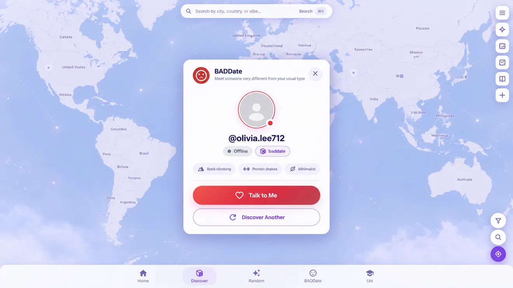</a>
<a href="docs/images/extras/02-alt-profile.webp">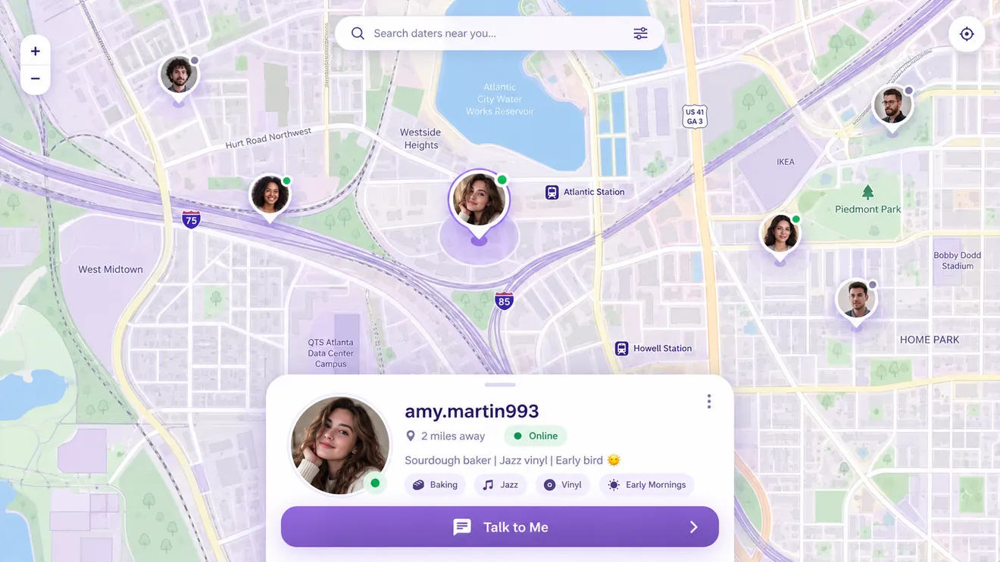</a>
<a href="docs/images/extras/03-alt-settings.webp">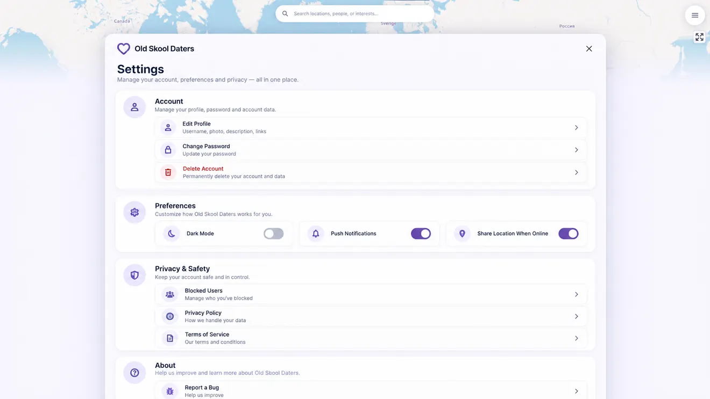</a>
<a href="docs/images/extras/04-alt-uni.webp">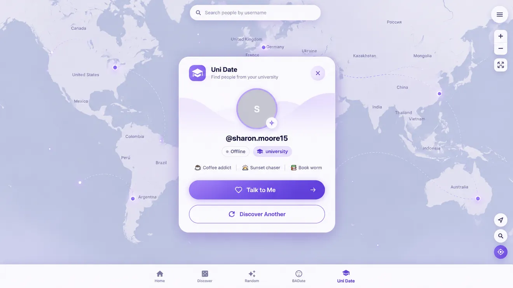</a>
<a href="docs/images/extras/05-alt-presentation.webp">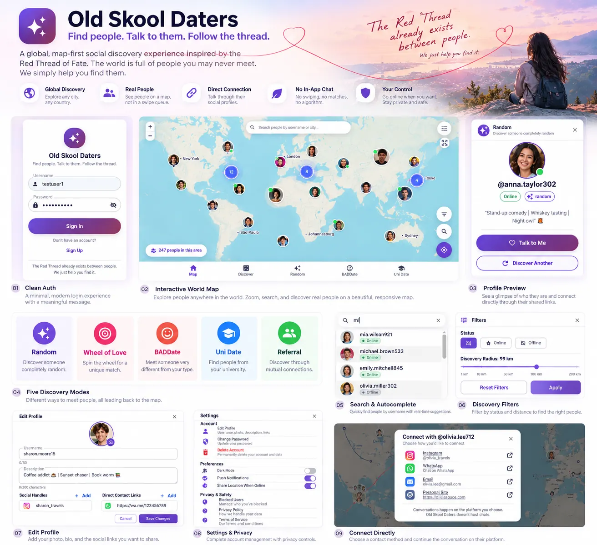</a>
<a href="docs/images/extras/06-alt-presentation-overview.webp">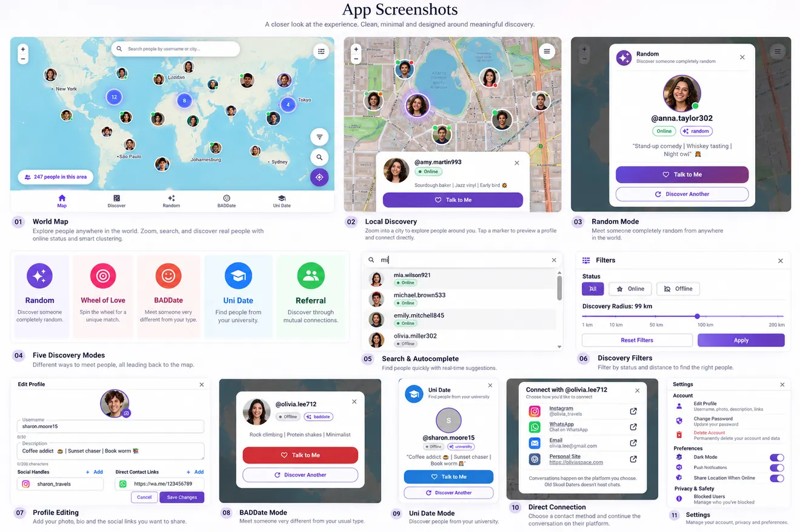</a>
<a href="docs/images/extras/07-globe-thread-brand.webp">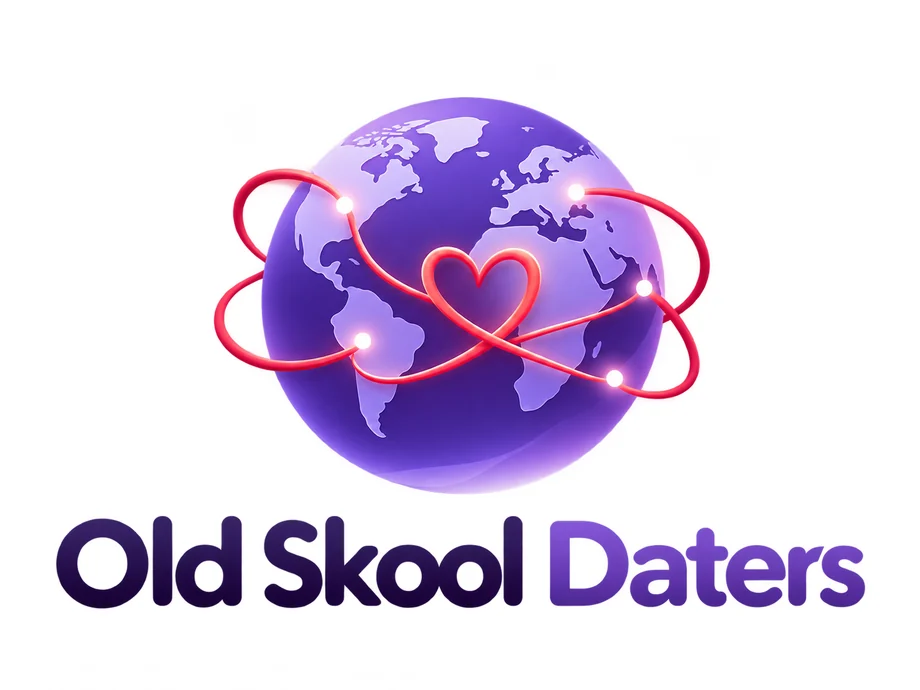</a>

</details>

---

## Current status

**Working locally:** accounts, map exploration, username search, basic profiles, Random, Wheel of Love, BADDate, Uni Date, referral discovery, and external contact handoff, based on the developer's local reports and screenshots.

**Still to finish before public use:** location precision and stale-location safeguards, meaningful adult-only access controls, moderation, abusive-contact prevention, profile privacy, and reliable testing. The visual designs in this README are proposals, not implemented UI claims.

> The Red Thread already exists between people. We just help you find it.

<p align="center"><b>Find people. Talk to them. Follow the thread.</b></p>
