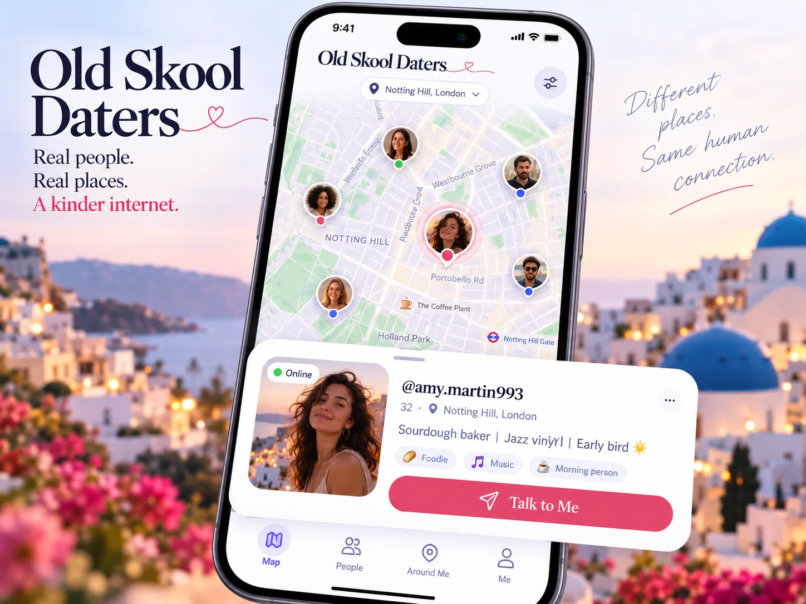
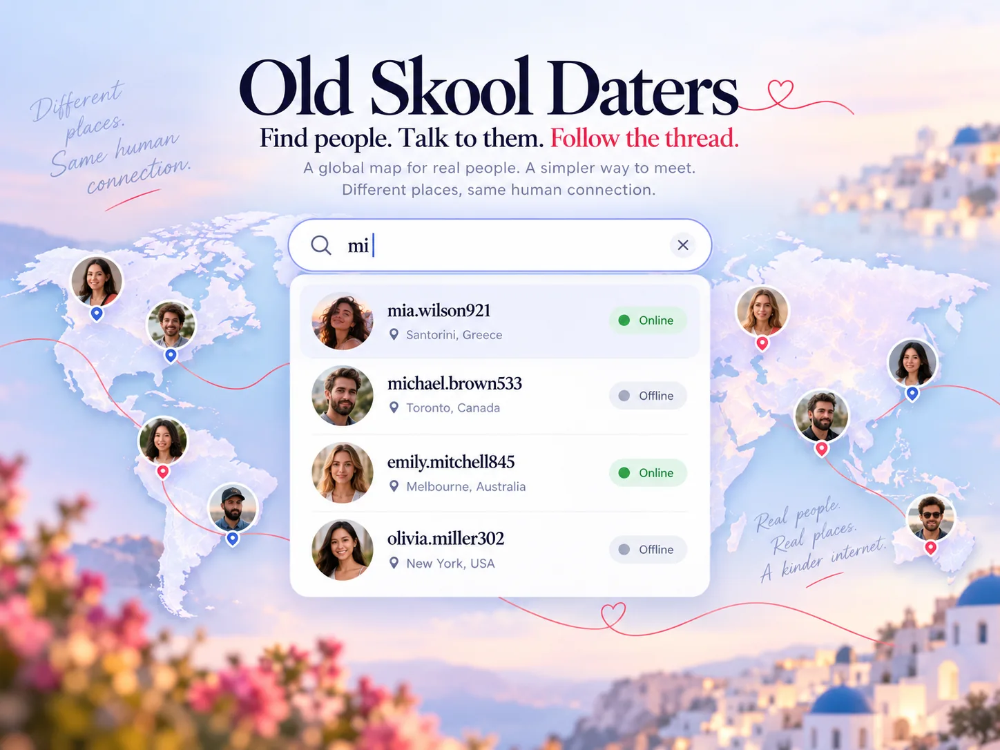
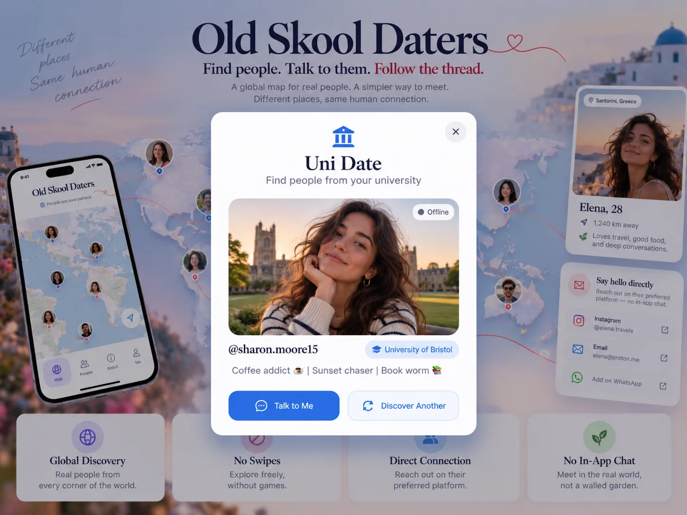
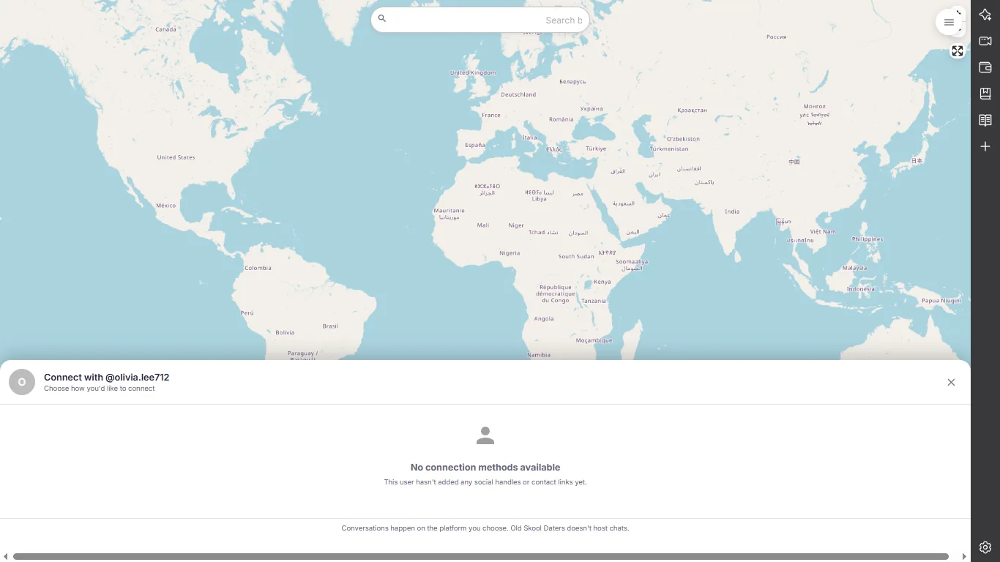
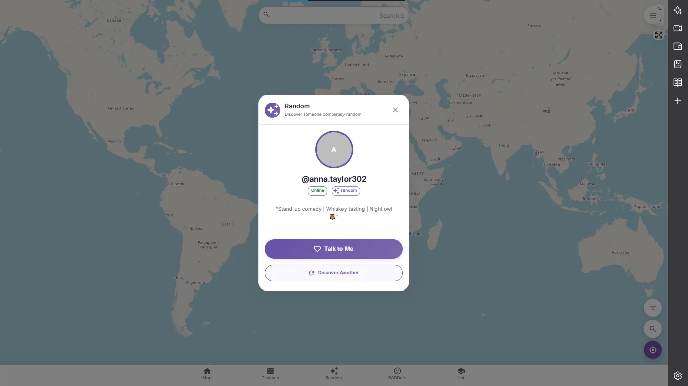
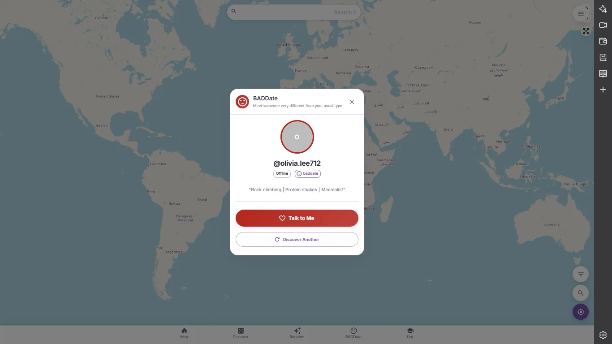
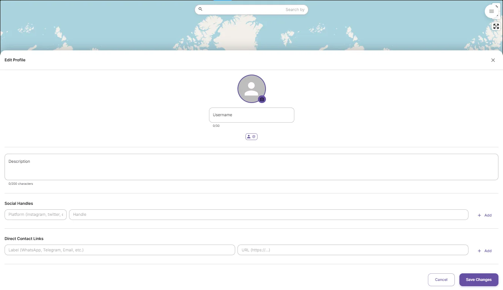
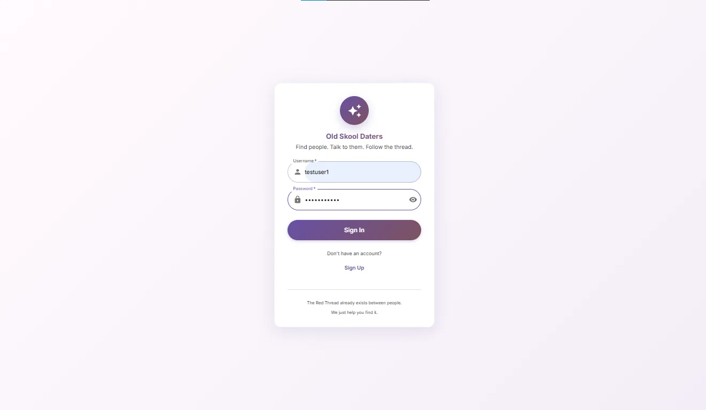

<div align="center">


<h1>Old Skool Daters</h1>

<h3>Find people. Talk to them. Follow the thread.</h3>

<strong>A world of people. A simpler way to connect.</strong>

<p><sub>Global human discovery · Inspired by the Red Thread of Fate · No swipes, match gates, or in-app chat</sub></p>

<br/><br/>


<sub>Illustrative design concept, not a screenshot of the live application. Example profiles, locations and contact details are fictional.</sub>

</div>

<p align="center"><a href="#why-this-exists">The idea</a> · <a href="#one-simple-journey">How it works</a> · <a href="#explore-the-experience">Designs</a> · <a href="#the-actual-local-prototype">Real screenshots</a> · <a href="#run-it-locally">Run locally</a></p>

## Why this exists

**Connection should not be a premium feature.**

Modern dating products can make something very human feel needlessly complicated: swipe through strangers, wait for a mutual match, pay to unlock a conversation, or stay inside an app just to say hello. The experience starts to feel less like meeting people and more like navigating a set of restrictions.

**Old Skool Daters grew out of that frustration.** Why should discovering someone and starting a conversation require so many steps?

This project explores another possibility. Open a map. Discover a person, nearby or anywhere in the world. Get a small glimpse of who they are. If they've chosen to share a way to reach them, use **Talk to Me** and continue on a platform you already use.

No swipe queue. No like counter. No platform-created compatibility score. No artificial match required before you're allowed to discover someone. And no paid gate built into the idea of saying hello.

> **The app should help people meet, not make meeting people complicated.**

## The Red Thread & the world map

The inspiration comes from the Japanese idea of **Akai Ito**, the *Red Thread of Fate*: an image of invisible threads connecting people whose paths may cross. Here, it's a metaphor, **not a promise that an app can find your destined partner**.

The **world map** gives that philosophy a practical form. Someone worth talking to could be in your neighborhood, another city, or halfway across the planet. You should be able to explore freely rather than waiting for an algorithm to decide who appears in front of you.

**The map makes discovery possible. The Red Thread explains why discovery matters.**

<div align="center">

<br/><sub>Design concept: global discovery, not a local-only swipe radius.</sub>
</div>

## One simple journey

<div align="center">

</div>

You don't have to like someone first, wait for a mutual match, buy credits, or unlock a chat feature. The other person controls which contact methods they choose to publish; **the app never promises access to private contact details or anyone's attention**.

## Explore the experience

The following screens are **individual design explorations** for the product's minimalist direction. They illustrate what the UI could look like. The current prototype screenshots appear in a separate section below.

### Discover people around the world

A calm, open map is the home screen, not an endless feed. Explore countries and cities, zoom into an area, and open small profile previews.

<p align="center"></p>

### Make discovery feel local when you want it to

Global doesn't mean distant. The same map can zoom into neighborhoods, with profiles shown as compact markers and cards rather than a separate matchmaking experience.

<p align="center"></p>

### Search without guessing what an algorithm wants

A username is enough to find someone directly. Search is a way to navigate the people on the map, not a compatibility-ranking engine.

<p align="center"></p>

### A few playful ways to discover someone

The map stays at the center. Five additional modes offer different ways to stumble across a person, without turning people into scores or a queue of winners and losers.

| Experience | The idea |
|:--|:--|
| **Random** | Discover an unexpected person. |
| **Wheel of Love** | Spin for a surprise. No notion of finding a mathematically perfect match. |
| **BADDate** | Meet someone outside your usual interests. "Different" is not "bad." |
| **Uni Date** | Discover people associated with your university. |
| **Love Referrals** | Find someone through a human recommendation, rather than a ranking system. |

<table>
<tr>
<td width="50%" align="center"><br/><b>Random</b></td>
<td width="50%" align="center"><br/><b>Wheel of Love</b></td>
</tr>
<tr>
<td align="center"><br/><b>BADDate</b></td>
<td align="center"><br/><b>Uni Date</b></td>
</tr>
</table>

**Love Referrals:** A friend can point someone toward another person. Its core idea is human introduction, not an automated match. Referral permissions and safeguards still need refinement.

### Talk to Me: the whole point

Profiles remain deliberately small: a photo, a unique username, an online/offline indication, a brief introduction, and only the contact methods that person chooses to share.

<p align="center"></p>

The app **doesn't host the conversation**. Select a published contact option and continue elsewhere. If someone hasn't shared a method, the app should explain that clearly rather than inventing one.

### Keep profiles and settings simple

<table>
<tr>
<td width="50%" align="center"><br/><b>A small, personal profile</b></td>
<td width="50%" align="center"><br/><b>Simple, transparent controls</b></td>
</tr>
</table>

The profile is not a résumé or a personality exam. Privacy settings and contact sharing should be understandable, and location must be handled carefully.

<details>
<summary><b>See the sign-in screen and no-contact state concepts</b></summary>
<br/>

<p align="center"></p>
<p align="center"></p>

</details>

---

## The actual local prototype

The images above are **design concepts**. These images show the **current locally running prototype**. They are intentionally kept separate so the design vision isn't mistaken for completed functionality.

<table>
<tr>
<td width="50%" align="center"><br/><b>World map</b></td>
<td width="50%" align="center"><br/><b>Search</b></td>
</tr>
<tr>
<td align="center"><br/><b>Profile preview</b></td>
<td align="center"><br/><b>Contact availability</b></td>
</tr>
</table>

<details>
<summary><b>More current screens: discovery, profile, settings and sign-in</b></summary>
<br/>

<table>
<tr><td width="50%"></td><td width="50%"></td></tr>
<tr><td></td><td></td></tr>
<tr><td></td><td></td></tr>
</table>

</details>

The prototype currently runs locally with a React frontend, an Express backend and a SQLite database. The discovery modes and external contact handoff are functional in local development. **Synthetic demo accounts do not represent actual active members.**

---

## What Old Skool Daters deliberately leaves out

| We don't want | Because |
|:--|:--|
| **Swipe queues and like counters** | People shouldn't be reduced to an approval game. |
| **Pay-to-talk gates** | The ability to start a conversation shouldn't be a premium reward. |
| **Artificial compatibility scores** | The product doesn't decide which human connection is "best." |
| **Required mutual-match unlocks** | Finding somebody shouldn't require another platform-controlled step. |
| **An in-app inbox or social feed** | The app is a doorway to conversation, not a place to keep everyone scrolling. |

That simplicity is a product choice, not a reason to remove necessary safety controls. Blocking, reporting, consent, age eligibility, contact privacy and protection of precise location data remain essential.

## Run it locally

You don't need to deploy the app to explore the prototype. Install **Node.js 22** and **pnpm**, then run these commands from the repository folder:

```bash
pnpm install
pnpm db:init
pnpm dev
```

Open **http://localhost:5173** in a browser. The application API runs locally at **http://localhost:3001**.

To generate demo profiles for testing:

```bash
cd packages/backend
npx tsx src/db/seed.ts
```

These demo profiles and their example contact details are synthetic. Keep development-only data and credentials out of a public deployment.

<details>
<summary><b>For developers: what does each part do?</b></summary>
<br/>

| Part | Plain-language explanation | Used here |
|:--|:--|:--|
| **Frontend** | Everything you see and tap in your browser. | React, TypeScript, MUI |
| **Backend / API** | The local service that handles accounts, searches and discovery requests. | Node.js, Express |
| **Database** | A file that stores accounts and their profile information. | SQLite |
| **Map** | Draws the world and lets you zoom, move and open markers. | MapLibre, OpenStreetMap tiles |
| **PWA** | An installable website that can feel like an app. It doesn't require a Play Store listing to run in your browser. | Vite PWA, Workbox |

This project uses a `pnpm` workspace, with the frontend in `packages/frontend`, the backend in `packages/backend`, and shared TypeScript types in `packages/shared`.

For the full folder structure and endpoint descriptions, see [PROJECT_DOCUMENTATION.md](PROJECT_DOCUMENTATION.md).

</details>

## Current stage & the road ahead

This repository represents a **working local prototype and an evolving visual direction**, not a production-ready dating service. The illustrated redesigns in this README are proposals, not claims about shipped UI features.

Before any public launch with real users, the most important work is accurate availability and location handling, consent-based contact sharing, meaningful adult eligibility checks, moderation, rate limiting and automated testing.

The product vision stays the same: **make discovery and conversation simpler, without rebuilding the paywalls and matchmaking machinery it was created to avoid.**

## A final thought

> The Red Thread already exists between people. We just help you find it.

**Find people. Talk to them. Follow the thread.**

<sub>License: no open-source license has been declared in this repository yet. The source remains subject to its owner's permissions.</sub>
